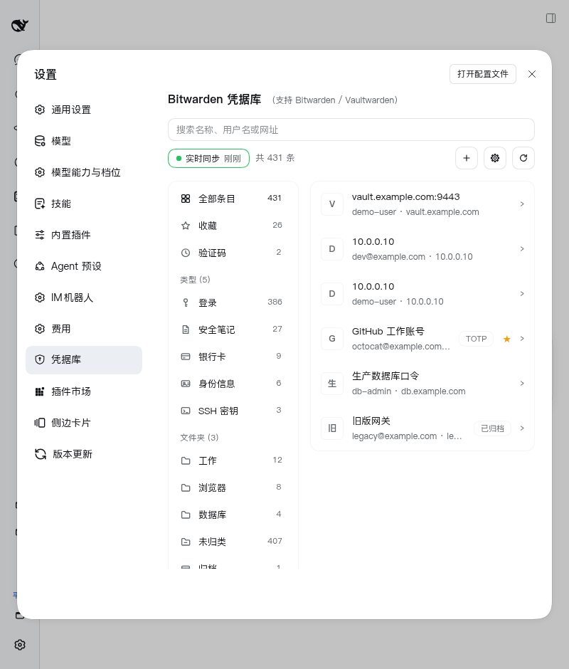
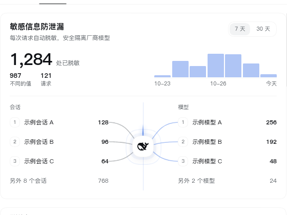

# dsh-vaultwarden

English | [中文](README.md)

A **Vaultwarden / Bitwarden** integration for DeepSeek Harness. Browse and edit the vault from **Settings → Password vault**, and let models search, read and write entries on demand. Passwords, TOTP codes and card data are masked with stable placeholders by default, and plaintext in local session logs can be scrubbed. Works with self-hosted Vaultwarden and Bitwarden Cloud.

## Preview

| Password vault | Masking trail |
| --- | --- |
|  |  |

## Highlights

- **Real-time sync & cache**: SignalR WebSocket updates, with automatic polling fallback and upgrade retries; an encrypted local cache plus revision probing speeds up cold starts.
- **Vault panel**: sections, search, paging, entry details, TOTP countdown, copy, create/edit, archive/trash/restore and folder moves; write actions follow the plugin's access tier.
- **Masking & log scrubbing**: passwords, TOTP codes and card data are returned as stable placeholders, fetchable per entry and field; plaintext in session logs is periodically replaced with `[REDACTED:BW]`, with incremental and immediate sweeps.
- **Masking dashboard**: daily totals, top conversations/models and a drill-down masking ledger.
- **Passkeys**: read passkey metadata from entries; export a 0600 WebAuthn credential file under the plugin's access tier, with import, remove and temporary-file cleanup; login recipe in [docs/passkey-login.md](docs/passkey-login.md).
- **Permissions & security**: read-only / ask / full-access tiers; when the DSH session is `workspace-write` or `read-only`, writes and passkey exports still go through host approval. The panel uses the host's authenticated `/api` RPC; the plugin serves no HTTP route of its own. Master password and API keys are write-only fields.
- **Settings page**: connection, sign-in, two-factor and plugin permissions in one place, for both self-hosted servers and Bitwarden Cloud.

## Install

```sh
# Latest stable tarball used by the marketplace
dsh plugin --profile web add https://github.com/BuvkB/dsh-vaultwarden/releases/latest/download/dsh-vaultwarden.tgz

# Or from npm
dsh plugin --profile web add dsh-vaultwarden@latest
```

Requires Node.js >= 22.

## Configuration

Open **Settings → Plugins → dsh-vaultwarden**:

| Field | Description |
| --- | --- |
| `serverUrl` / `email` | Vaultwarden URL and login email |
| `masterPassword` | Master password; write-only |
| `apiKeyClientId` / `apiKeyClientSecret` | Optional API-key login (bypasses two-factor prompts) |
| `accessMode` | `readonly` / `ask` / `auto` for model-driven writes |
| `maskMode` / `sweepMode` | Placeholder masking and log-scrubbing switches |

When the DSH session is `workspace-write` / `read-only` (`approval: ask`), writes and passkey exports still require host approval even if the plugin is set to `auto`. Password/TOTP reads, log scrubbing and passkey temporary-file cleanup do not require approval; the latter two are forced security cleanups.

`DSH_BITWARDEN_*` environment variables and profile composition are also supported. See [docs/ui-design.md](docs/ui-design.md) for every field.

## Tools

`bitwarden_find` · `bitwarden_get` · `bitwarden_reveal` · `bitwarden_status` · `bitwarden_sync` · `bitwarden_folders` · `bitwarden_create` · `bitwarden_update` · `bitwarden_delete` · `bitwarden_restore`

Passkeys: `bitwarden_passkey_list` · `bitwarden_passkey_export` · `bitwarden_passkey_cleanup` · `bitwarden_passkey_import` · `bitwarden_passkey_remove`; login recipe in [docs/passkey-login.md](docs/passkey-login.md).

`bitwarden_sweep` immediately scrubs Bitwarden plaintext from local session logs.

## Masking notes

- Placeholders look like `{{BW_PASSWORD_xxxxxxxx}}`; they are HMAC-derived, irreversible and can be referenced, compared or fetched per field.
- The dashboard and ledger details live in [docs/ui-design.md](docs/ui-design.md).
- `[REDACTED:BW]` means plaintext was written to disk and later scrubbed; it has no salt for reverse lookup.

## Development

```sh
bash scripts/build.sh        # full gate
node test/client-card.test.mjs
node test/trail.test.mjs
```

Release steps: [docs/release.md](docs/release.md).

## Links

- [GitHub Releases](https://github.com/BuvkB/dsh-vaultwarden/releases)
- [npm](https://www.npmjs.com/package/dsh-vaultwarden)
- [Issues](https://github.com/BuvkB/dsh-vaultwarden/issues)

## License

MIT. Third-party notices: [THIRD-PARTY-NOTICES.md](THIRD-PARTY-NOTICES.md).
