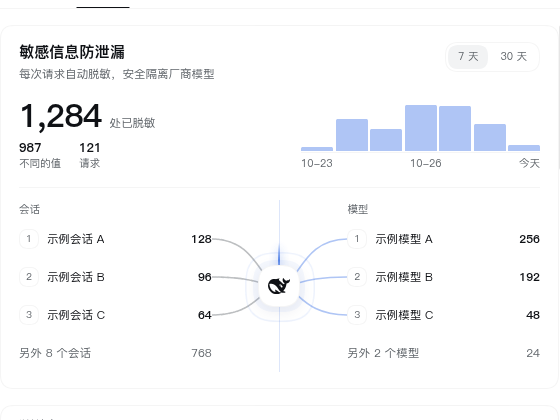

# dsh-vaultwarden

English | [中文](README.md)

A Vaultwarden / Bitwarden integration for DeepSeek Harness. Every session can search and read the vault on demand, server changes arrive over WebSocket, requests are masked before they leave, plaintext in local session logs can be scrubbed, and **Settings → Password vault** provides the vault browser and masking dashboard.

## Preview

| Password vault | Masking trail |
| --- | --- |
|  |  |

## Highlights

- **Real-time sync**: SignalR WebSocket updates, with automatic polling fallback and upgrade retries.
- **Vault panel**: sections, search, paging, entry details, TOTP countdown, copy, archive/trash and optional write actions.
- **Masking**: passwords, TOTP codes and card data are returned as stable placeholders; plaintext can be fetched per entry and field only when needed.
- **Log scrubbing**: Bitwarden plaintext in session logs is replaced with `[REDACTED:BW]`; incremental scanning and immediate sweep are supported.
- **Masking dashboard**: daily totals, top three conversations and models, a gate view with three full left-to-right beams (grey before masking, blue after) and one grey particle per beam, plus the masking ledger and detail pages.
- **Security posture**: the panel uses the host's authenticated `/api` connection RPC; the plugin serves no HTTP route of its own. Master password and API keys are write-only fields.

## Install

```sh
# Latest stable tarball used by the marketplace
dsh plugin --profile web add https://github.com/BuvkB/dsh-vaultwarden/releases/latest/download/dsh-vaultwarden.tgz

# Or from npm
dsh plugin --profile web add dsh-vaultwarden@latest
```

Requires Node.js >= 22.

## Configuration

Open **Settings → Plugins → dsh-vaultwarden**:

| Field | Description |
| --- | --- |
| `serverUrl` / `email` | Vaultwarden URL and login email |
| `masterPassword` | Master password; write-only |
| `apiKeyClientId` / `apiKeyClientSecret` | Optional API-key login (bypasses two-factor prompts) |
| `accessMode` | `readonly` / `ask` / `auto` for model-driven writes |
| `maskMode` / `sweepMode` | Placeholder masking and log-scrubbing switches |

`DSH_BITWARDEN_*` environment variables and profile composition are also supported. See [docs/ui-design.md](docs/ui-design.md) for every field.

## Tools

`bitwarden_find` · `bitwarden_get` · `bitwarden_status` · `bitwarden_sync` · `bitwarden_folders` · `bitwarden_create` · `bitwarden_update` · `bitwarden_delete` · `bitwarden_restore`

`bitwarden_sweep` immediately scrubs Bitwarden plaintext from local session logs.

## Masking notes

- Placeholders look like `{{BW_PASSWORD_xxxxxxxx}}`; they are HMAC-derived, irreversible and can be referenced, compared or fetched per field.
- The dashboard and ledger details live in [docs/ui-design.md](docs/ui-design.md).
- `[REDACTED:BW]` means plaintext was written to disk and later scrubbed; it has no salt for reverse lookup.

## Development

```sh
bash scripts/build.sh        # full gate
node test/client-card.test.mjs
node test/trail.test.mjs
```

Release steps: [docs/release.md](docs/release.md).

## Links

- [GitHub Releases](https://github.com/BuvkB/dsh-vaultwarden/releases)
- [npm](https://www.npmjs.com/package/dsh-vaultwarden)
- [Issues](https://github.com/BuvkB/dsh-vaultwarden/issues)

## License

MIT. Third-party notices: [THIRD-PARTY-NOTICES.md](THIRD-PARTY-NOTICES.md).
