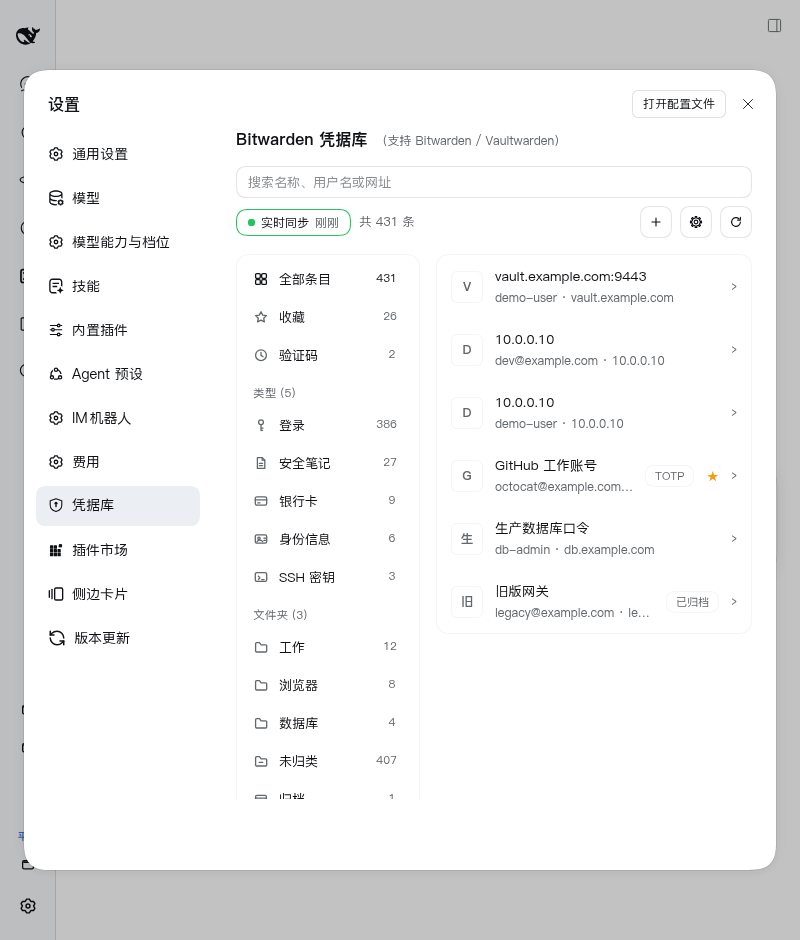
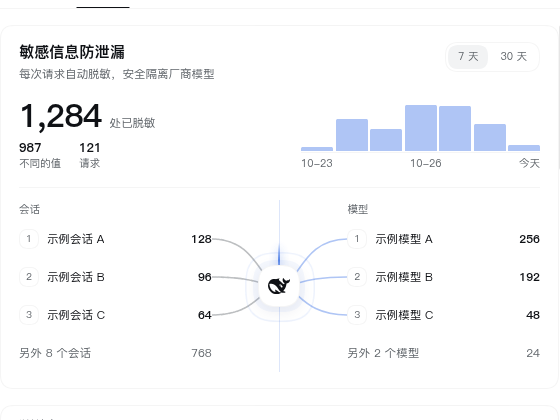

# dsh-vaultwarden

[English](README.en.md) | 中文

把 **Vaultwarden / Bitwarden** 接入 DeepSeek Harness。密码库可在「设置 → 密码库」里浏览和编辑，模型可按需检索、读取和写入；密码、TOTP、卡号等默认以占位符脱敏，会话日志中的明文也可擦除。支持自建 Vaultwarden 与官方 Bitwarden 云。

## 界面预览

| 密码库面板 | 脱敏轨迹 |
| --- | --- |
|  |  |

## 主要能力

- **实时同步与缓存**：SignalR WebSocket 推送变更；不可用时自动降级轮询并定期重试升级；本地加密缓存与 revision 探测让冷启动更快。
- **密码库面板**：分区导航、搜索、分页、条目详情、TOTP 倒计时、复制、创建/编辑、归档/回收站/恢复与文件夹移动；写操作按权限档控制。
- **脱敏与日志擦除**：工具读取密码、TOTP、卡号等返回稳定占位符，按条目 + 字段单次取回；定期把会话日志中的明文替换为 `[REDACTED:BW]`，支持增量与立即擦除。
- **脱敏看板**：按天统计脱敏量与前三会话/模型，保留可下钻的脱敏流水和详情。
- **通行密钥**：读取条目中的 passkey 元数据；按插件权限导出为 0600 的 WebAuthn 凭据文件，支持导入、移除和临时文件清理；登录配方见 [docs/passkey-login.md](docs/passkey-login.md)。
- **权限与安全边界**：插件权限分只读 / 每次确认 / 完全权限；DSH 会话处于 `workspace-write` / `read-only` 时，写操作与通行密钥导出仍走宿主审批。面板使用宿主已认证的 `/api` RPC，插件不注册自己的 HTTP 路由；主密码和 API 密钥是只写字段。
- **设置页**：连接、登录、两步验证与插件权限集中管理，支持自建服务器与官方 Bitwarden 云。

## 安装

```sh
# 最新稳定版（市场条目使用的地址）
dsh plugin --profile web add https://github.com/BuvkB/dsh-vaultwarden/releases/latest/download/dsh-vaultwarden.tgz

# 或从 npm 安装
dsh plugin --profile web add dsh-vaultwarden@latest
```

要求 Node.js >= 22。

## 配置

在 **设置 → 插件 → dsh-vaultwarden** 填写：

| 字段 | 说明 |
| --- | --- |
| `serverUrl` / `email` | Vaultwarden 地址与登录邮箱 |
| `masterPassword` | 主密码；只写，不落浏览器 |
| `apiKeyClientId` / `apiKeyClientSecret` | 可选，API 密钥登录（可绕过两步验证） |
| `accessMode` | `readonly` / `ask` / `auto`，控制模型工具的写回权限 |
| `maskEnabled` | 插件脱敏总开关（默认开启）。关闭后不再返回占位符、不显示脱敏轨迹页，凭据会以明文进入会话日志；仅在已使用其它本地脱敏服务时关闭 |
| `sweepMode` | 日志擦除开关（受 `maskEnabled` 约束） |

DSH 会话权限为 `workspace-write` / `read-only`（`approval: ask`）时，即使插件 `accessMode` 为 `auto`，写操作与通行密钥导出也会走审批；密码/TOTP 读取、日志擦除与通行密钥临时文件清理不需要审批，后两者属于强制执行的安全清理。

也支持 `DSH_BITWARDEN_*` 环境变量和 profile 组合配置。完整字段见 [docs/ui-design.md](docs/ui-design.md)。

## 工具

`bitwarden_find` · `bitwarden_get` · `bitwarden_reveal` · `bitwarden_status` · `bitwarden_sync` · `bitwarden_folders` · `bitwarden_create` · `bitwarden_update` · `bitwarden_delete` · `bitwarden_restore`

通行密钥：`bitwarden_passkey_list` · `bitwarden_passkey_export` · `bitwarden_passkey_cleanup` · `bitwarden_passkey_import` · `bitwarden_passkey_remove`；登录配方见 [docs/passkey-login.md](docs/passkey-login.md)。

另有 `bitwarden_sweep` 立即擦除本地会话日志中的明文。

## 脱敏说明

- 插件脱敏默认开启；如果你已经使用其它本地脱敏服务，可在 设置 → 插件 → dsh-vaultwarden 关闭它，关闭后「脱敏轨迹」页不再显示，密码等字段会以明文进入模型上下文和会话日志，存在泄露风险。
- 占位符形如 `{{BW_PASSWORD_xxxxxxxx}}`，由 HMAC 生成，不可逆；只能引用、比较或按字段取回。
- 脱敏看板与流水详情见 [docs/ui-design.md](docs/ui-design.md)。
- 擦除标记 `[REDACTED:BW]` 表示明文曾经落盘、随后被擦除；它没有可反查的盐。

## 开发

```sh
bash scripts/build.sh        # 全量门禁
node test/client-card.test.mjs
node test/trail.test.mjs
```

发布流程见 [docs/release.md](docs/release.md)。

## 链接

- [GitHub Releases](https://github.com/BuvkB/dsh-vaultwarden/releases)
- [npm](https://www.npmjs.com/package/dsh-vaultwarden)
- [问题反馈](https://github.com/BuvkB/dsh-vaultwarden/issues)

## 许可

MIT。第三方项目见 [THIRD-PARTY-NOTICES.md](THIRD-PARTY-NOTICES.md)。
