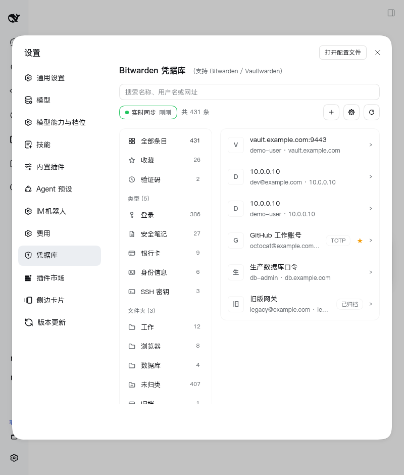

# dsh-vaultwarden

[English](README.en.md) | 中文

把 **Vaultwarden / Bitwarden** 接入 DeepSeek Harness：每个会话都能按需检索和读取密码库；服务器变更通过 WebSocket 实时同步；请求发出前自动脱敏，落盘日志中的明文可被擦除，并在「设置 → 密码库」提供密码浏览与脱敏看板。



## 主要能力

- **实时同步**：登录后订阅 SignalR WebSocket，服务器变更即时刷新；不支持 WebSocket 时自动降级轮询并定期重试升级。
- **密码库面板**：分区导航、搜索、列表分页、条目详情、TOTP 倒计时、复制、归档/回收站与可选的写操作。
- **脱敏模式**：工具读取到的密码、TOTP、卡号等以稳定占位符返回；需要明文时按条目 + 字段单次取回。
- **日志擦除**：定期把会话日志中的 Bitwarden 明文替换为 `[REDACTED:BW]`，支持增量扫描与立即擦除。
- **脱敏看板**：按天统计脱敏量，展示脱敏量前三的会话与模型；每根连接线一颗灰色粒子穿过门禁，左灰右蓝分别表示脱敏前/后；底部保留脱敏流水与详情页。
- **安全边界**：面板走宿主已认证的 `/api` connection RPC，插件不注册自己的 HTTP 路由；主密码和 API 密钥是只写字段。

## 安装

```sh
# 最新稳定版（市场条目使用的地址）
dsh plugin --profile web add https://github.com/BuvkB/dsh-vaultwarden/releases/latest/download/dsh-vaultwarden.tgz

# 或从 npm 安装
dsh plugin --profile web add dsh-vaultwarden@latest
```

要求 Node.js >= 22。

## 配置

在 **设置 → 插件 → dsh-vaultwarden** 填写：

| 字段 | 说明 |
| --- | --- |
| `serverUrl` / `email` | Vaultwarden 地址与登录邮箱 |
| `masterPassword` | 主密码；只写，不落浏览器 |
| `apiKeyClientId` / `apiKeyClientSecret` | 可选，API 密钥登录（可绕过两步验证） |
| `accessMode` | `readonly` / `ask` / `auto`，控制模型工具的写回权限 |
| `maskMode` / `sweepMode` | 占位符脱敏与日志擦除开关 |

也支持 `DSH_BITWARDEN_*` 环境变量和 profile 组合配置。完整字段见 [docs/ui-design.md](docs/ui-design.md)。

## 工具

`bitwarden_find` · `bitwarden_get` · `bitwarden_status` · `bitwarden_sync` · `bitwarden_folders` · `bitwarden_create` · `bitwarden_update` · `bitwarden_delete` · `bitwarden_restore`

另有 `bitwarden_sweep` 立即擦除本地会话日志中的明文。

## 脱敏说明

- 占位符形如 `{{BW_PASSWORD_xxxxxxxx}}`，由 HMAC 生成，不可逆；只能引用、比较或按字段取回。
- 脱敏看板与流水详情见 [docs/ui-design.md](docs/ui-design.md)。
- 擦除标记 `[REDACTED:BW]` 表示明文曾经落盘、随后被擦除；它没有可反查的盐。

## 开发

```sh
bash scripts/build.sh        # 全量门禁
node test/client-card.test.mjs
node test/trail.test.mjs
```

发布流程见 [docs/release.md](docs/release.md)。

## 链接

- [GitHub Releases](https://github.com/BuvkB/dsh-vaultwarden/releases)
- [npm](https://www.npmjs.com/package/dsh-vaultwarden)
- [问题反馈](https://github.com/BuvkB/dsh-vaultwarden/issues)

## 许可

MIT。第三方项目见 [THIRD-PARTY-NOTICES.md](THIRD-PARTY-NOTICES.md)。
